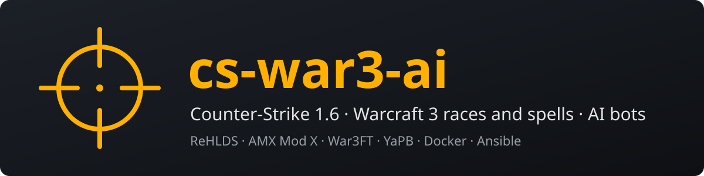

# cs-war3-ai

English (official): [../../README.md](../../README.md)

Un serveur public Counter-Strike 1.6 avec War3FT (les races et les sorts de Warcraft 3) et une IA : des bots qui
répondent, et un maître du jeu. Et le code pour monter le tien.

## Le jeu

- Respawn : tu réapparais tout de suite, pas de manches, pas d'attente. Choisis tes armes avec **G**. 3 secondes
  de protection à chaque réapparition, perdues dès que tu tires.
- Choisis une des 8 races (Mort-vivant, Humain, Orc, Elfe de la nuit…). Chacune a 3 compétences et un ultime.
- Gagne de l'XP, monte de niveau, débloque des compétences. Ton XP est gardée, race par race : tu la retrouves la
  fois suivante.
- Les niveaux viennent deux fois plus vite que d'habitude, et une race jamais jouée commence au niveau 3 : ton
  ultime (niveau 6) arrive vite.
- Des bots remplissent le serveur quand il y a peu de monde. Un s'en va pour chaque humain qui arrive. Ils
  répondent : nomme-en un dans le chat, ou pose une question avec un `?`. Ils se souviennent de toi et de votre
  dernière carte ensemble ; tue-en un souvent, et il te garde rancune. Et un maître du jeu (une IA) lance des primes,
  des duels et d'autres surprises, nomme le MVP de chaque carte, et écrit chaque nuit le journal du serveur.
- Un objectif de la semaine, le même pour tous (`/goal`), avec son tableau sur le site de stats.
- `/coach` : un coach IA regarde tes chiffres sur cette carte et te donne un conseil, en privé. Un bilan vers la
  fin de chaque carte.
- Un annonceur pour le premier kill, les multi-kills et les séries, jusqu'à GODLIKE. Tes dégâts s'affichent sous
  le viseur.
- 14 succès à débloquer (`/ach`, le plus proche s'affiche à chaque carte), et la place du top 10 affichée dans le
  chat. Le top 3 du mois passé reçoit un tag `[Champion]` et une place au Hall of fame.
- 10 cartes classiques (de_dust2, de_inferno, cs_office…) ; un vote choisit la suivante, et `rtv` demande un vote
  tout de suite.
- Les classements sur [cs.pazpop.net](https://cs.pazpop.net) : celui du mois (repart de zéro le 1er), l'XP par
  race, le combat, et une page par joueur (`/mystats` donne la tienne).
- Tu arrives sur un serveur de bots seuls : la partie redémarre, les scores de la carte repartent de
  zéro (l'XP et les classements restent).
- Serveur à 1000 FPS, Amérique du Nord (est).

Comment marche le mod : [war3ft.md](war3ft.md).

## Rejoindre le serveur

Il faut Counter-Strike 1.6 sur Steam. Puis, au choix :

- Sur [cs.pazpop.net](https://cs.pazpop.net), clique sur **Join the server**.
- Dans la console du jeu (la touche sous Échap), tape `connect cs.pazpop.net:27015`.

En jeu : `/help` affiche le guide, `rtv` demande une nouvelle carte, `votekick` lance un vote pour expulser un
joueur. Le règlement (13 ans ou plus, le respect, pas de haine, pas de triche) :
[war3ft.md](war3ft.md#le-règlement). Pour un jeu fluide : [client.md](client.md).

## Monter ton propre serveur

Le serveur tourne dans Docker sur un VPS, déployé avec Ansible : [installation.md](installation.md).

## Licence

Notre code est sous [licence MIT](../../LICENSE). Les briques qu'il télécharge gardent leurs propres licences (voir
le guide d'installation). Les voix de l'annonceur sont d'Antti Saari et TripleSnail, sous CC-BY 3.0
([server/sound/announcer/CREDITS.txt](../../server/sound/announcer/CREDITS.txt)). Les images du site de stats ont
été faites avec PixelLab ([stats/img/CREDITS.txt](../../stats/img/CREDITS.txt)).
